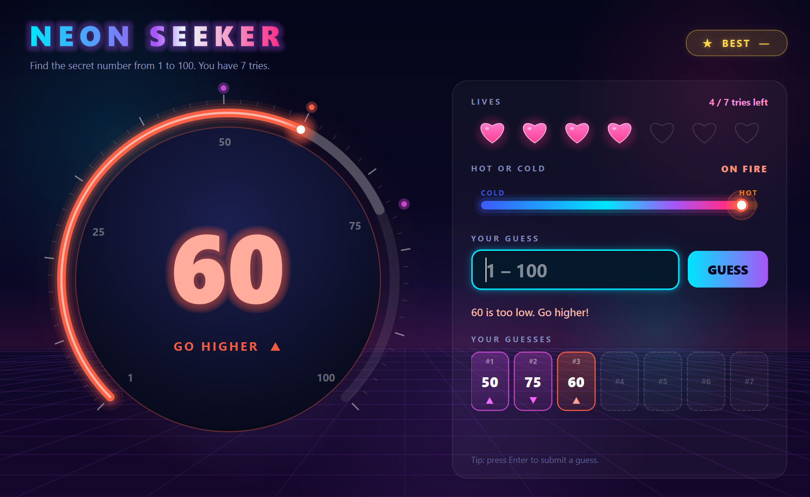
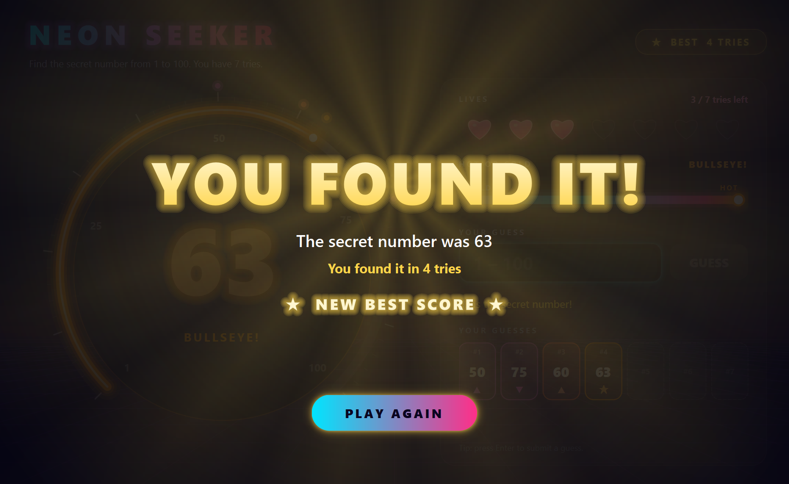
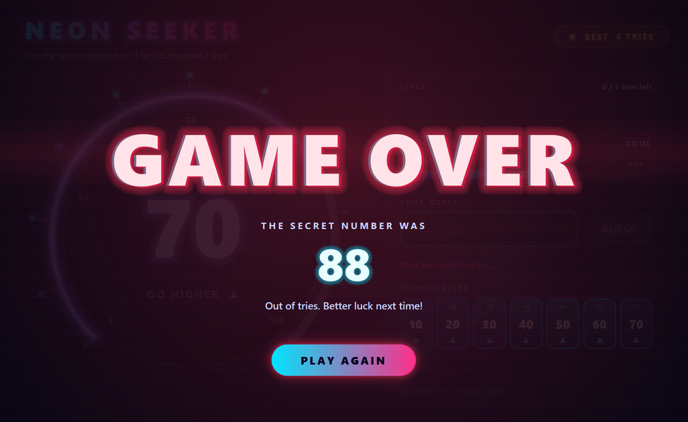

# Neon Seeker

A glowing number-guessing game for Windows, grown out of a classic school exercise.

The game picks a secret number from 1 to 100. You have **7 tries** to find it.
After every guess it tells you to go **higher** or **lower**, and a hot-or-cold bar shows how close you are.



## What's in it

- A big round dial that glides to each guess and shows which numbers are still possible
- A "hot or cold" bar that springs to how close your guess was
- 7 glowing hearts, one fades away for every try you use
- A history of all your guesses, coloured from cold (blue) to hot (orange)
- Confetti when you win, an animated game-over screen when you don't
- Your best score (fewest tries) is remembered between games
- Friendly messages if you type something that isn't a whole number from 1 to 100
- Keyboard friendly: type a number and press **Enter**; press **Enter** again to play another round

| You found it! | Game over |
| --- | --- |
|  |  |

## Install and run

You need **Windows** and **Python 3.10 or newer** ([download Python](https://www.python.org/downloads/)).

1. Download this project: click the green **Code** button on GitHub, then **Download ZIP**, and unzip it.
   (Or, if you use Git: `git clone https://github.com/BorjanAI/number-game.git`)
2. Open a terminal in the project folder (in File Explorer, click the address bar, type `cmd` and press Enter).
3. Create a private Python space for the game and install what it needs:

   ```bash
   python -m venv .venv
   .venv\Scripts\python -m pip install -r requirements.txt
   ```

4. Start the game:

   ```bash
   .venv\Scripts\python neon_seeker.py
   ```

## Build the app yourself

This turns the game into a normal Windows program you can start by double-clicking, no Python window needed.

```bash
.venv\Scripts\python build.py
```

The finished app is in `dist\Neon Seeker\Neon Seeker.exe`.
Add `--shortcut` to also put a **Number Game** shortcut on your Desktop:

```bash
.venv\Scripts\python build.py --shortcut
```

## Where is my best score saved?

In a tiny file called `.neon_seeker_best.json` in your Windows user folder. Delete it to reset your best score.

## Made with

- [Python](https://www.python.org/)
- [PySide6](https://doc.qt.io/qtforpython-6/) (Qt for Python) for the window and all the drawing
- [PyInstaller](https://pyinstaller.org/) to package it as a Windows app

## License

MIT. See [LICENSE](LICENSE).
